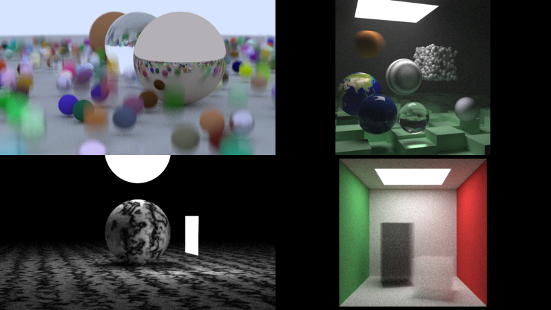

# lucyray



My version of [Ray Tracing in One Weekend - The Book Series](https://raytracing.github.io/), [book 1](https://raytracing.github.io/books/RayTracingInOneWeekend.html) and [book 2](https://raytracing.github.io/books/RayTracingTheNextWeek.html). Written by hand in Odin.

Some features added:

- It's multi-threaded. Work is divided into 32x32 tiles. Threads take the next tile to render, with an atomic counter.
- Fast random generator
- Monte Carlo sampling for random points

Build and usage example (pass a number from 0 to 9 to choose the scene to render):

```
odin build lucyray.odin -file -o:speed
.\lucyray.exe 0 
```
